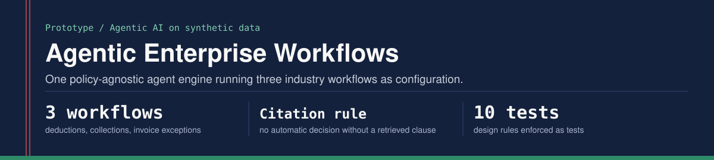

<p align="center"></p>

One policy-agnostic agentic engine, three industry workflows:

| Workflow | Process family | Industry | What the agents decide |
|---|---|---|---|
| `o2c_deductions` | Order to Cash | Consumer Goods and Retail | Is a customer short-pay valid (credit it) or invalid (dispute and rebill)? |
| `bfsi_collections` | Lending lifecycle, credit to recovery | Banking and Financial Services | What is the right next action on an early-delinquency borrower response? |
| `s2p_invoice_exceptions` | Source to Pay | Cross-industry | Release, hold or escalate an invoice that failed three-way match? |

The point of the repo is the design, not the model. Each workflow is pure configuration - categories, evidence rules, policy clauses, human-in-the-loop triggers and a value baseline - and the same engine runs all three. Adding a fourth workflow (Record to Report journal exceptions, Hire to Retire onboarding) is a new folder under `workflows/`, not new code.

## What it demonstrates

- **Workflow logic, states, handoffs and exception paths.** Every case moves through an explicit state graph (`engine/state_machine.py`). Illegal transitions raise, so a design gap fails a test instead of shipping.
- **Where AI replaces a step, where it augments, and where a person stays in control.** Clear, grounded, low-value cases resolve automatically. Missing evidence becomes a request, not a guess. Low confidence, ungrounded answers, high value, regulated categories (borrower hardship, no-PO invoices) and flagged accounts go to a person - with the agent's context and recommendation already assembled.
- **Agent roles.** Intake (classify), Evidence (check rules), Policy (retrieve and cite), Decision (propose action and draft the note). One job each, narrow contracts (`engine/agents.py`).
- **RAG grounding with a hard rule.** An automatic decision must cite a policy clause that was actually retrieved and that belongs to the decided category. A test enforces it.
- **Guardrails measured against human decisions.** A simulated reviewer decides from ground truth, the way a UAT reference set would, so the dashboard reports auto-decision accuracy and how often the agent's recommendation matched the reviewer.
- **The value case.** Baseline versus agentic effort, time to resolve, annualized hours and cost released, and value identified for recovery - on labelled assumptions that a real engagement replaces with the client's measured baseline.
- **Token cost.** Grounded top-k context is compared with sending the full policy corpus on every call.

## Results on the synthetic sets (deterministic mode)

| Workflow | Straight-through | Routed to a person | Held for evidence | Auto-decision accuracy | Agent matched reviewer |
|---|---|---|---|---|---|
| O2C deductions | 57.5% | 37.5% | 5.0% | 91.3% | 81.8% |
| BFSI collections | 47.5% | 52.5% | 0.0% | 89.5% | 88.2% |
| S2P invoice exceptions | 40.0% | 50.0% | 10.0% | 100.0% | 86.7% |

Every error is visible in the audit trail. They come from mixed-signal cases, such as a borrower who says they already paid *and* disputes a penalty in the same message. The design lesson, written up in `docs/workflow-design.md`, is that multi-intent messages need their own guardrail rather than a better classifier.

These are synthetic cases built to exercise the design. They are not client data and the numbers are not a performance claim.

## Run it

Python 3.9+, standard library only.

```bash
python run_demo.py                          # all three workflows
python run_demo.py --workflow o2c_deductions
python -m unittest discover -s tests -v     # 10 tests
```

Dashboards and audit logs are written to `sample_outputs/`. Open `sample_outputs/o2c_deductions_dashboard.html` in a browser.

Optional: with `pip install anthropic` and `ANTHROPIC_API_KEY` set, `python run_demo.py --llm` uses Claude for intake classification and for drafting resolution notes. LLM output passes through the same guardrails, and any note citing a clause that was not retrieved is discarded for the template.

## Layout

```
engine/            state machine, agents, guardrails, retrieval, value model, dashboard
workflows/<name>/  config.json, policy_clauses.json, cases.json
tools/             seeded synthetic case generator
tests/             design rules enforced as tests
docs/              workflow design, exception paths, value model, production path
sample_outputs/    generated dashboards and audit logs
```

## How this was built

The guardrail and release standards here come from programs I ran: exit criteria agreed before build, testing against human decisions, clear human-in-the-loop boundaries and a tested rollback path. I set the brief and those standards, and Claude, an AI assistant, designed the engine with me and wrote the code. I work at the design, requirements and evaluation layer, and I do not write or review application code. This is a working prototype meant to make a design concrete quickly, not a production system; `docs/workflow-design.md` covers what production would need.

Prateek Ratnakar | [prateek-ratnakar.github.io](https://prateek-ratnakar.github.io) | [LinkedIn](https://www.linkedin.com/in/prateekratnakar)
