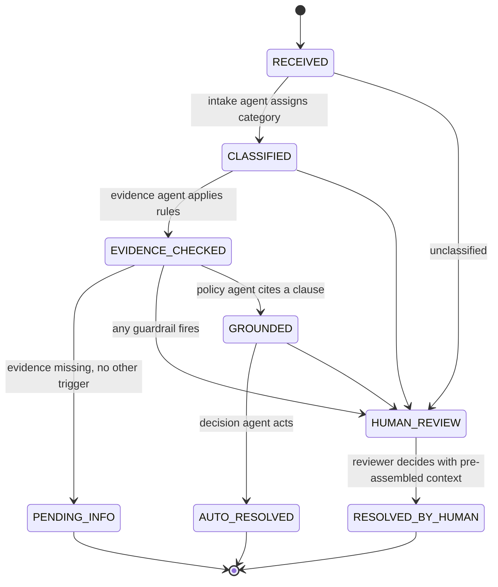

# Workflow design

## 1. The state graph (shared by every workflow)

Terminal states are `AUTO_RESOLVED`, `PENDING_INFO` and `RESOLVED_BY_HUMAN`. Every transition writes an audit entry with the actor (which agent, or the reviewer) and the reason.

## 2. Handoffs

| From | To | What is handed over |
|---|---|---|
| Intake agent | Evidence agent | Category and confidence |
| Evidence agent | Policy agent | Evidence status: valid, invalid or incomplete, with the failed or missing rules |
| Policy agent | Decision agent | Retrieved clause ids, cited clause ids, grounding scores |
| Guardrails | Human reviewer | The reasons it fired, plus the agent's proposal when one exists |
| Evidence agent | Customer or supplier | A request naming the exact missing evidence |

## 3. Exception paths

| Exception | Detected by | Path |
|---|---|---|
| No category signal | Intake agent | Straight to a person |
| Low confidence, including mixed-signal messages | Guardrails | Person, with the agent's best guess |
| Evidence missing | Evidence agent | `PENDING_INFO` with a named request, never a guessed decision |
| No clause clears the grounding threshold | Policy agent and guardrails | Person; the agent may not decide without a citation |
| Value above the auto-decision limit | Guardrails | Person |
| Regulated or judgment-heavy category | Config `human_only_categories` | Always a person |
| Account flag (key account, legal hold, vulnerable customer, sanctions hit) | Config `human_review_flags` | Always a person |

## 4. Where people stay in control, per workflow

**O2C deductions.** Automatic: small, clearly stated, evidence-complete deductions. Person: anything above the limit, key accounts, legal holds. The commercial relationship is a judgment call, not a rule.

**BFSI collections.** Automatic: promise-to-pay booking within policy, payment found in ledger, charges applied in error. Person, always: financial hardship (restructuring is a credit decision, and fair-practice conduct rules apply), vulnerable customers, escalated complaints, legal notices. Wrong-party contacts never trigger any disclosure.

**S2P invoice exceptions.** Automatic: variance within tolerance, goods receipt matches, duplicate check clear, tax code matches master. Person, always: no-PO invoices (retrospective approval belongs to the budget owner), first invoices from new suppliers, sanctions screening hits.

## 5. Value model

Baseline and agentic effort, time to resolve, volume and cost per hour live in each `config.json` under `value_model`, labelled as assumptions. On an engagement the sequence is:

1. Measure the baseline on the client's own cases before design sign-off.
2. Agree the KPIs and the business case with the finance owner before build.
3. Run the agents against a reference set of real historical cases scored against human decisions (this repo's simulated reviewer stands in for that).
4. Roll out by cohort, track realization against the baseline, and keep the rollback path tested.

## 6. What the errors taught

The auto-decision errors in the sample runs are mixed-signal messages - two reasons in one note. A higher-accuracy classifier would not fix them; a multi-intent guardrail that splits or routes such cases would. That is the next design iteration.

## 7. Production path

| Prototype | Production |
|---|---|
| TF-IDF over ten clauses per workflow | Vector store over the client's contracts, SOPs and policies, with clause-level metadata |
| Keyword intake, optional Claude | LLM intake with calibrated confidence, evaluated on a reference set |
| Simulated reviewer | Real review queue in the case system, with reviewer decisions fed back as labels |
| Python orchestrator | Orchestration framework (for example LangGraph nodes mapping one-to-one to these agents and states), with retries and observability |
| JSON audit log | Immutable audit store for regulatory and internal audit review |
| Assumed baseline | Measured baseline, finance-owned business case, benefits tracked monthly |
